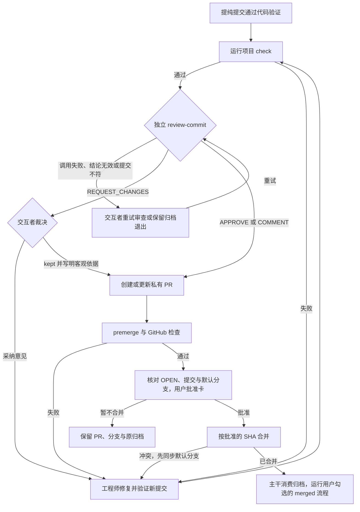

# 工作流编排与并发派工约定

## 1. 开工确认与并发派工（`DECISION_JSON`）

常规开发从需求分支读取或生成 `.dickda/tasks/PLAN_5L.md`，随后暂停。交互者先向用户讲解各层取舍，填写开工建议、理由与风险。用户可在确认卡选择开工、打回修订或暂不开工。只有确认开工才进入主控，显式选择 `fast` 时直接进入主控。

主控续跑会拿到需求分支当前 HEAD、相对上次视图的新提交与 `git diff --stat`，按提示同步到这个提交再决策。派工时若提供了里程碑且有主会话，流程通过 `tell-session` 按运行与轮次同步一次。

`dickda-develop` 中的执行主控（`lead`）每轮输出结构化决策 JSON，支持三种核心动作：

- **`dispatch`（并发派发 1..N 个工单）**：
  - 每个工单包含 `id`、`trade`（`architect | builder | verifier`）、`difficulty`（`normal | hard`）、可选 `tier`（`standard | senior`）、`title`、`task`、`lockSpec`（`builder` 默认 `true`，禁止修改 `.dickda/lints` 与已锁定 `.dickda/verifiers`）。
  - BPMN 使用无序并行多实例（`multiInstanceLoopCharacteristics`）在各自独立工作树同时调用 `coda-agent` 执行同批全部工单。
  - 工单只写自己的 `.dickda/tasks/logs/<jobId>.md`。打回的提交有临时远端引用，使用原 ID 或通过 `replaces` 重派时可从 `previousHead` 查看前次改动和失败原因。工单合入或交付时清理引用。
  - 批次结束后自动用 `git merge-tree` 无冲突校验合入需求分支 `dickda/req-<runId>`；发生冲突或违反 `lockSpec` 的工单自动记为被打回并累加 `rejections` 计数。
- **`verify`** 先用 `remember` 将有效调查日志连同需求和五层方案归入 `.dickda/learning/<timestamp>/` 并提交。用归档后的 SHA 补跑项目检查、双轨验证与独立 `review-commit`。双轨失败退回主控。独立审查未完成可重试或停止。终审要求修改可派修新提交，对同一已通过双轨的提交选择不采纳时，主控须在 `ignoredFindings` 逐条填写客观依据。PR 与用户批准卡保留原结论、依据和验证证据。
- **`escalate`（向上请示交互者）**：仅在遇到破坏 `PLAN_5L.md` 顶层设计、对外契约变更或高级工程师仍无法消解的阻塞风险时触发，流程挂起 `userTask` 交顶层交互者会话拍板。

## 2. 两级工程师升级逻辑

`roles.mjs` 按以下规则自动解析工单执行人：

1. 工单显式指定 `tier: "senior"`，或标注 `difficulty: "hard"` → 直接选用该工种**高级工程师**；
2. 该工单历史 `rejections >= escalationThreshold`（默认 2 次） → 自动升级选用**高级工程师**，并在工单提示中附带前序失败原因与上一分支参考提交；
3. 其余常规工单选用**常规工程师**。

## 3. 私有交付 PR 与并发隔离

- 同一 Git 仓库共用 `dickda:<projectId>` 宿主独占组（`exclusive=true, borrow=no`），防止并发运行覆写 `.dickda/tasks/`。
- 交付 PR 通过剥离 `CODA_THREAD_ID` 的私有 `gh` 创建与更新，避免重复触发外部独立 PR 生命周期流程。

## 4. 双轨验证与设备

`dickda-verify` 对同一提交并行运行代码轨与可选 Agent/UI 轨。启用 UI 时先检出该 SHA，递归检查 `.dickda/verifiers/`。只有发现 Agent/UI 规约且填写了设备，才执行 `resolve-testbed` 和 `hold-group`。有规约而未指定设备时直接验收。无规约时记录该提交的跳过结果。开发流程将 `verifier`、`verifierSenior` 透传到验证流程，当前运行的覆盖优先于插件设置。

## 5. 提纯归档与合并

思考者诊断最早的未消费批次，交互者选择落点后在专属提纯分支执行。可以为本次运行指定思考者，也可覆盖架构、实现、验证各自的常规和高级配置。每次修复从提纯分支最新提交开始，交付须为严格后代且通过 L2/L3 代码验证才推送。工程师受阻或自动修复达到升级阈值加一次后，交互者可补充指示继续，或停止并保留原归档。

增量复评以已评提交为基线，附上带编号且仍待解决的必须修项。信息不完整时回到完整评审。PR 与批准卡列出归档批次、落点、验证摘要、原审查结论和不采纳依据。批准与实际合并都会核对 PR 的提交及当前默认分支。合并使用插件设置的方式、`--match-head-commit` 和 `--delete-branch`，以 GitHub 返回的合并提交运行所选后续流程。
