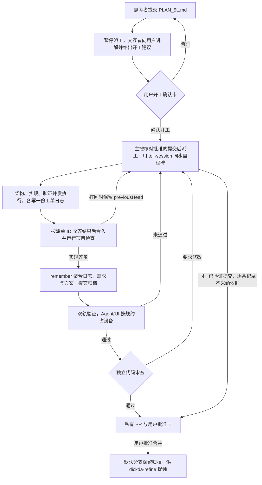

# dickda模式（`dickda`）

以五层倒金字塔（**Codebase → Static Analysis → Verification → Prose → Human Review**）为核心的 Coda 多 Agent 工程插件：采用**交互者-思考者-执行者（主控 / 架构 / 实现 / 验证四工种，支持两级难度升级与并发派工）**架构，并将项目全部配置、任务方案、可执行规约、测试验证器与知识经验统一收归 **`.dickda/`** 目录管理。

从旧插件切换时，先记下自定义设置，在项目中停用旧插件并启用 `dickda`。仓库里的 `.dickda/` 资产可直接复用。在原设置生效的范围内，把自定义值填入新插件的对应项，例如交互者用 `dickda.interactor`，合并方式用 `dickda.mergeMethod`。各项只更换键前缀，值的格式相同。

## 1. 三角色 · 四工种体系

每个槽位均可在 Coda 插件设置或流程参数中覆盖，开箱默认编制如下：

| 角色 / 工种 | 标识 | 常规级默认配置 | 高级默认配置（高难或多次打回自动升级） | 核心职责 |
| --- | --- | --- | --- | --- |
| **交互者** | `interactor` | `antigravity / gemini-4-neon (xhigh)` | — | 主会话用户沟通、HTML 控制台与图文汇报（`visualize`）、风险与重构拍板 |
| **思考者** | `thinker` | `antigravity / gemini-4-carbon (high)` | — | 输出面向五层抽象的 `.dickda/tasks/PLAN_5L.md` 顶层方案，并在 `refine` 中诊断落层 |
| **执行 · 主控** | `lead` | `antigravity / gemini-4-neon (xhigh)` | — | 执行期总调度：支持**并发派发**三工种任务、自主裁决 Review 取舍、控制升级与向上风控 |
| **执行 · 架构** | `architect` | `antigravity / claude-opus-5-5 (high)` | `antigravity / gemini-4-carbon (high)` | 落地 L1 架构骨架、实现 L2 `.dickda/lints/` 可执行规约、设计 L3 `.dickda/verifiers/` 测试靶子 |
| **执行 · 实现** | `builder` | `codex / gpt-6.2-astra (high)` | `codex / gpt-6.2-astra (max)` | 科学复现、实验回退与工程编码实现（默认锁定规约，禁止擅自弱化 Lint 与 Verifier） |
| **执行 · 验证** | `verifier` | `codex / gpt-6.1-sol (high)` | `codex / gpt-6.1-sol (max)` | 专职找问题、独立 `review-commit` 代码审查与黑盒 / UI 自动化实证验收 |

## 2. 工作流概览



- **`dickda`** 加入 `hook="develop"`。显式填写 `device` 时，流程先调用 `resolve-testbed`，设备解析成功才创建需求分支。思考者只能提交 `.dickda/tasks/PLAN_5L.md` 的改动。复用或修订方案都需用户确认，首轮派单前核对确认卡上的提交 SHA。显式选择 `fast` 时以 `seed.head` 开工。主控续跑时收到当前提交、相对上轮的提交与改动统计，以及同步工作树的命令。终审会收到项目检查摘要、双轨报告、实证证据与发现。终审要求修改时，主控可重派工单，或对同一已验证提交逐条给出客观依据。PR 和批准卡同时展示原结论与依据，交用户裁决。
- **`dickda-verify`** 在启用 UI 轨且指定设备时先调用 `resolve-testbed`，成功后才并行检查同一提交。代码轨运行 L2 Lint 和 L3 脚本。UI 轨检出该提交，有 Agent/UI 规约时才占用指定设备并验收，未指定设备可直接验收。通过结论须附非空摘要和至少一项实证证据。没有规约会记录跳过。`verifier` 和 `verifierSenior` 可覆盖插件设置。
- **`dickda-refine`** 取得项目独占锁后拉取最新默认分支，再选择最早的未消费归档。指定的起始分支有独立提交时也会跳过主干已消费的批次。没有待处理归档时直接结束。
  思考者须给出有效工单或具体的 L4 文档条目，交互者据此选择落点。首次执行和每轮修复都须在目标归档之外留下实际改动。「仅更新 L4」限于 `.dickda/knowledge/` 下的 Markdown 文档和 `.dickda/learning/Learning_*.md`，同步默认分支时须原样保留其他路径的上游变更。
  工程师提交后运行代码验证和项目检查，再做独立审查。审查未完成可重试或停止，要求修改可派修或写明不采纳依据。私有 PR 通过合并前和 GitHub 检查后，用户批准该提交合入默认分支，归档才在主干完成消费。冲突会退回同步、修复、重验和重新批准。「暂不合并」保留 PR、分支与主干归档。

`dickda` 和 `dickda-refine` 只接受仓库默认分支作为 `base`，留空时自动读取。可用 `branch` 指定工作的起始分支。

## 3. `.dickda/` 统一资产目录

```text
.dickda/
  project.json          # 项目标识、已启用规范与验证命令配置
  project.md            # 构建、测试、预览运行与受保护路径事实
  tasks/
    TODO_TASK.md        # 当前需求逐字原文
    PLAN_5L.md          # 五层技术方案
    logs/<jobId>.md     # 各并发工单自己的调查记录，交付前按批次聚合归档
    logs/investigate.md # 没有工单 ID 的调查记录
  lints/                # L2 Executable Spec 脚本（*.mjs / *.sh）
  verifiers/            # L3 结果导向测试脚本与 Agent/UI 验收规约
  knowledge/            # L4 知识库（Index.md 等）
  learning/             # L4 学习计数与时间戳调查归档
  prompts/              # 项目自定义规范（*.json；内置含 general 与 cpp）
```

工作树私有运行锁存放于 `<git-dir>/dickda/`，不随提交或克隆传播。

## 4. 常用命令与校验

```sh
dickda init
dickda role list
dickda role resolve builder --rejections 2
dickda lint
dickda verify --track code
dickda dashboard
```

`dickda dashboard` 生成自包含的交互式 HTML 控制台。用返回的 `path` 在 Coda 会话中通过 `visualize` 展示。

开发自检：

```sh
node bin/check.mjs plugins/dickda
node --test test/plugins/dickda.test.mjs
```

内置通用与 C++ 规范片段遵循 Apache-2.0，归因详见 [NOTICE](NOTICE)。
