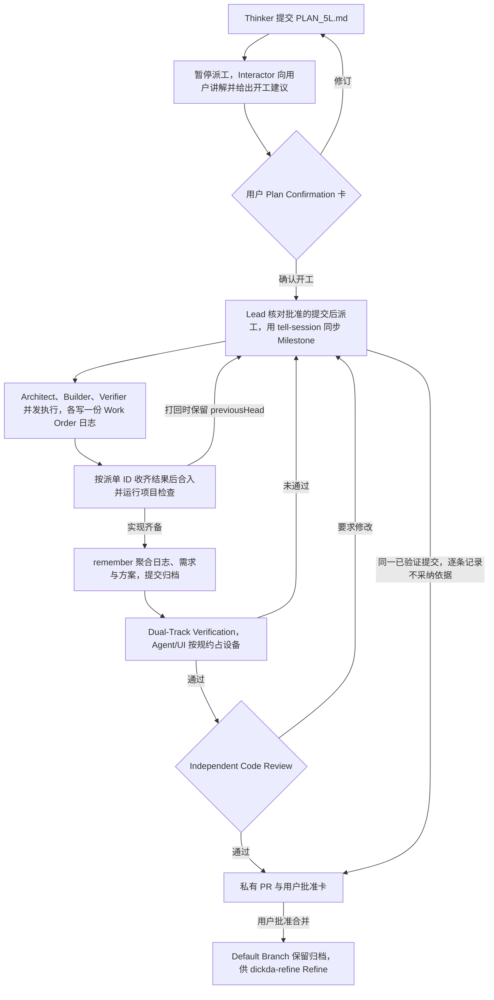

# dickda

以 Inverted Pyramid（**Codebase → Static Analysis → Verification → Work Graph & Prose → Human Review**）为核心的 Coda 多 Agent 工程插件：采用**Interactor-Thinker-Executors（Lead / Architect / Builder / Verifier 四工种，支持 Tier Escalation 与并发派工）**架构，并将项目全部配置、任务方案、Executable Spec、测试验证器与知识经验统一收归 **`.dickda/`** 目录管理。

从旧插件切换时，先记下自定义设置，在项目中停用旧插件并启用 `dickda`。仓库里的 `.dickda/` 资产可直接复用。在原设置生效的范围内，把自定义值填入新插件的对应项，例如 Interactor 用 `dickda.interactor`，合并方式用 `dickda.mergeMethod`。各项只更换键前缀，值的格式相同。

## 1. 三角色 · 四工种体系

每个槽位均可在 Coda 插件设置或流程参数中覆盖，开箱默认编制如下：

| 角色 / 工种 | 标识 | Standard 默认配置 | Senior 默认配置（高难或多次打回自动升级） | 核心职责 |
| --- | --- | --- | --- | --- |
| **Interactor** | `interactor` | `antigravity / gemini-4-neon (xhigh)` | — | 主会话用户沟通、HTML 控制台与图文汇报（`visualize`）、风险与重构拍板 |
| **Thinker** | `thinker` | `antigravity / gemini-4-carbon (high)` | — | 输出面向五层抽象的 `.dickda/tasks/PLAN_5L.md` 顶层方案，并在 `refine` 中诊断落层 |
| **Thinker · Heavy Mode · Coordinator** | `thinkerCoordinator` | `antigravity / gemini-4-neon (xhigh)` | — | 综合双方修订稿、裁决分歧并提交定稿 |
| **Thinker · Heavy Mode · Carbon** | `thinkerCarbon` | `antigravity / gemini-4-carbon (high)` | — | 独立初稿、交叉 Review、按意见修订 |
| **Thinker · Heavy Mode · Astra** | `thinkerAstra` | `codex / gpt-6.2-astra (high)` | — | 独立初稿、交叉 Review、按意见修订 |
| **Executors · Lead** | `lead` | `antigravity / gemini-4-neon (xhigh)` | — | 执行期总调度：支持**并发派发**三工种任务、自主裁决 Review 取舍、控制升级与向上风控 |
| **Executors · Architect** | `architect` | `antigravity / claude-opus-5-5 (high)` | `antigravity / gemini-4-carbon (high)` | 落地 L1 架构骨架、实现 L2 `.dickda/lints/` Executable Spec、设计 L3 `.dickda/verifiers/` 测试靶子 |
| **Executors · Builder** | `builder` | `codex / gpt-6.2-astra (high)` | `codex / gpt-6.2-astra (max)` | 科学复现、实验回退与工程编码实现（默认锁定规约，禁止擅自弱化 Lint 与 Verifier） |
| **Executors · Verifier** | `verifier` | `codex / gpt-6.1-sol (high)` | `codex / gpt-6.1-sol (max)` | 专职找问题、独立 `review-commit` 代码审查与黑盒 / UI 自动化实证验收 |

所有内部 `antigravity` 会话统一使用 `mode: "full"`，包括自定义设置和工作流覆盖；其他 Agent 保留原模式。续跑会话沿用已有模式，不传 `--mode`。

`heavyThink` 默认 `false`，普通规划及 `dickda-refine diagnose` 继续使用 `dickda.thinker`（Refine 保持单 Thinker JSON 诊断）。开启 **Heavy Mode** 后，Carbon 与 Astra 并发独立出稿 → 并发交叉 Review → 并发各自修订 → Coordinator（默认 Neon）综合定稿，共 7 次模型调用。每阶段收齐并校验两份产物后才继续。三个独立槽位的优先级为本次工作流输入覆盖 > 插件设置 > 内置默认值；所有 `antigravity` 槽位强制 `mode: "full"`，`codex` 默认不带 mode。

**Fast Mode 与 Heavy Mode 互斥**，在 `lane` 创建或推送分支前拒绝冲突。Heavy Mode 即使继承已有 `PLAN_5L.md` 也重新规划，旧方案作为背景；本运行已确认方案的恢复一律直接回到 Lead。Interactor 或用户退回会递增独立的 **Plan Round**（`planRound`，与 Lead 的 `round` 分离），携带最新反馈完整重跑四阶段。只有定稿通过严格后代、仅修改 `PLAN_5L.md` 和 L1–L5 正文门禁后才推送、清除反馈并进入 Plan Confirmation。

中间产物仅存于 `<git-dir>/dickda/heavy-think/<runId>/round-<planRound>/` 和 `CODA_PLUGIN_STATE/runs/<project>/<runId>/heavy-think/round-<planRound>/`，不进入 Git 工作树。同轮同输入指纹可复用已完成阶段；成功产出当前 HEAD 且无新反馈时可幂等返回。格式不完整可同会话补齐一次；普通 Thinker 与 Coordinator 未提交时最多续跑两次完成交付。`dickda dashboard` 展示 Heavy Mode 槽位及最近运行的 Plan Round、Dispatch Round。

## 2. 工作流概览



- **`dickda`** 加入 `hook="develop"`。显式填写 `device` 时，流程先调用 `resolve-testbed`，设备解析成功才创建 Requirement Branch。Thinker 只能提交 `.dickda/tasks/PLAN_5L.md` 的改动。复用或修订方案都需用户确认，首轮派单前核对确认卡上的提交 SHA。显式选择 `fast` 时以 `seed.head` 开工。Lead 续跑时收到当前提交、相对上轮的提交与改动统计，以及同步工作树的命令。Final Review 会收到项目检查摘要、Dual-Track Verification 报告、实证证据与发现。Final Review 要求修改时，Lead 可重派 Work Order，或对同一已验证提交逐条给出客观依据。PR 和批准卡同时展示原结论与依据，交用户裁决。
- **`dickda-verify`** 在启用 Agent/UI Track 且指定设备时先调用 `resolve-testbed`，成功后才并行检查同一提交。Code Track 运行 L2 Lint 和 L3 脚本。Agent/UI Track 检出该提交，有 Agent/UI 规约时才占用指定设备并验收，未指定设备可直接验收。通过结论须附非空摘要和至少一项实证证据。没有规约会记录跳过。`verifier` 和 `verifierSenior` 可覆盖插件设置。
- **`dickda-refine`** 取得项目独占锁后拉取最新 Default Branch，再选择最早的 Pending Archive。指定的起始分支有独立提交时也会跳过主干已消费的批次。没有 Pending Archive 时直接结束。
  Thinker 须给出有效 Work Order 或具体的 L4 文档条目，Interactor 据此选择落点。首次执行和每轮修复都须在目标归档之外留下实际改动。「仅更新 L4」限于 `.dickda/knowledge/` 下的 Markdown 文档和 `.dickda/learning/Learning_*.md`，同步 Default Branch 时须原样保留其他路径的上游变更。
  工程师提交后运行代码验证和项目检查，再做 Independent Code Review。审查未完成可重试或停止，要求修改可派修或写明不采纳依据。私有 PR 通过合并前和 GitHub 检查后，用户批准该提交合入 Default Branch，归档才在主干完成消费。冲突会退回同步、修复、重验和重新批准。「暂不合并」保留 PR、分支与主干归档。

`dickda` 和 `dickda-refine` 只接受仓库 Default Branch 作为 `base`，留空时自动读取。可用 `branch` 指定工作的起始分支。

## 3. `.dickda/` 统一资产目录

```text
.dickda/
  project.json          # 项目标识、已启用规范与验证命令配置
  project.md            # 构建、测试、预览运行与受保护路径事实
  tasks/
    TODO_TASK.md        # 当前需求逐字原文
    PLAN_5L.md          # Five-Layer Plan
    logs/<jobId>.md     # 各并发 Work Order 自己的调查记录，交付前按批次聚合归档
    logs/investigate.md # 没有 Work Order ID 的调查记录
  lints/                # L2 Executable Spec 脚本（*.mjs / *.sh）
  verifiers/            # L3 Outcome-Oriented Verification 脚本与 Agent/UI 验收规约
  knowledge/            # L4 Knowledge Base（Index.md 等）
  learning/             # L4 学习计数与时间戳 Investigation Archive
  prompts/              # 项目自定义规范（*.json；内置含 general 与 cpp）
```

工作树私有运行锁存放于 `<git-dir>/dickda/`，不随提交或克隆传播。

## 4. 常用命令与校验

```sh
dickda init
dickda role list
dickda role resolve builder --rejections 2
dickda lint
dickda verify --track code
dickda dashboard
```

`dickda dashboard` 生成自包含的交互式 HTML 控制台。用返回的 `path` 在 Coda 会话中通过 `visualize` 展示。

`dickda --help`、`dickda -h` 和 `dickda role --help` 可在任何目录查看用法。

开发自检：

```sh
node bin/check.mjs plugins/dickda
node --test test/plugins/dickda.test.mjs
```

内置通用与 C++ 规范片段遵循 Apache-2.0，归因详见 [NOTICE](NOTICE)。
