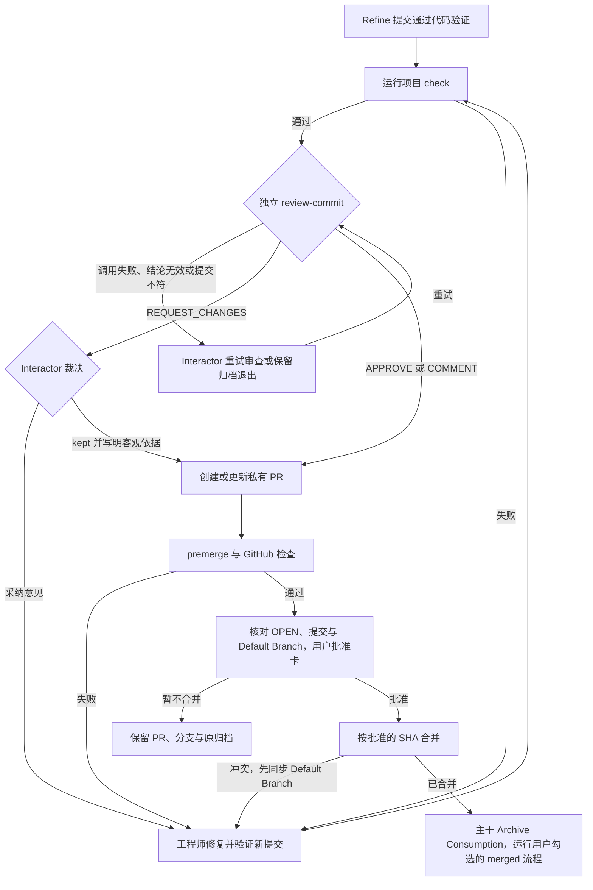

# 工作流编排与并发派工约定

## 1. Plan Confirmation 与并发派工（`DECISION_JSON`）

Standard 开发从 Requirement Branch 读取或生成 `.dickda/tasks/PLAN_5L.md`，Thinker 的提交只能改动这份方案。Interactor 先向用户讲解各层取舍，填写开工建议、理由与风险。用户可在确认卡选择开工、打回修订或暂不开工。首轮派单要求 Requirement Branch HEAD 与本次 Plan Confirmation 卡的 SHA 一致。显式选择 `fast` 时以 `seed.head` 为基线。

Lead 续跑会拿到 Requirement Branch 当前 HEAD、相对上次视图的新提交与 `git diff --stat`，按提示同步到这个提交再决策。派工时若提供了 Milestone 且有主会话，流程通过 `tell-session` 按运行与轮次同步一次。

`dickda` 中的执行 Lead（`lead`）每轮输出结构化决策 JSON，支持三种核心动作：

- **`dispatch`（并发派发 1..N 个 Work Order）**：
  - 每个 Work Order 包含 `id`、`trade`（`architect | builder | verifier`）、`difficulty`（`normal | hard`）、可选 `tier`（`standard | senior`）、`title`、`task`、`lockSpec`（`builder` 默认 `true`，禁止修改 `.dickda/lints` 与已锁定 `.dickda/verifiers`）。
  - BPMN 使用无序并行多实例（`multiInstanceLoopCharacteristics`）在各自独立工作树同时调用 `coda-agent` 执行同批全部 Work Order。
  - Work Order 只写自己的 `.dickda/tasks/logs/<jobId>.md`。同批及历史 ID 均按大小写不敏感规则检查冲突。复用原 ID 或以 `replaces` 指向被打回的 Work Order 时，须与 Work Order Ledger 中的 ID 完全一致。打回的提交有临时远端引用，可从 `previousHead` 查看前次改动。Work Order 合入或交付时清理引用。
  - 合入前按当轮派单快照核对每个结果的 ID，缺失、多余或重复都会中止合入。通过后用 `git merge-tree` 校验并发改动并合入 Requirement Branch `dickda/req-<runId>`。发生冲突或违反 `lockSpec` 的 Work Order 记为被打回并累加 `rejections` 计数。
- **`verify`** 要求每张被打回的编码或验证 Work Order 已重派通过，或在本轮 `ignoredFindings` 按 ID 逐条写明不采纳的客观依据。随后用 `remember` 将有效调查日志连同需求和 Five-Layer Plan 归入 `.dickda/learning/<timestamp>/` 并提交。归档后的 SHA 通过项目检查与 Dual-Track Verification 后，独立 `review-commit` 收到项目检查摘要和本轮 Dual-Track Verification 报告、实证证据与发现。Dual-Track Verification 失败退回 Lead。Independent Code Review 未完成可重试或停止。Final Review 要求修改可派修新提交，对同一已通过 Dual-Track Verification 的提交选择不采纳时，Lead 须在 `ignoredFindings` 逐条填写客观依据。PR 与用户批准卡保留原结论、依据和验证证据。
- **`escalate`（向上请示 Interactor）**：仅在遇到破坏 `PLAN_5L.md` 顶层设计、对外契约变更或 Senior Engineer仍无法消解的阻塞风险时触发，流程挂起 `userTask` 交顶层 Interactor 会话拍板。

## 2. Tier Escalation

`roles.mjs` 按以下规则自动解析 Work Order 执行人：

1. Work Order 显式指定 `tier: "senior"`，或标注 `difficulty: "hard"` → 直接选用该工种**Senior Engineer**；
2. 该 Work Order 历史 `rejections >= escalationThreshold`（默认 2 次） → 自动升级选用**Senior Engineer**，并在 Work Order 提示中附带前序失败原因与上一分支参考提交；
3. 其余 StandardWork Order 选用**Standard Engineer**。

## 3. 私有交付 PR 与并发隔离

- 同一 Git 仓库共用 `dickda:<projectId>` 宿主独占组（`exclusive=true, borrow=no`），防止并发运行覆写 `.dickda/tasks/`。
- 交付 PR 通过剥离 `CODA_THREAD_ID` 的私有 `gh` 创建与更新，避免重复触发外部独立 PR 生命周期流程。

## 4. Dual-Track Verification 与设备

`dickda-verify` 对同一提交并行运行 Code Track 与可选 Agent/UI Track。启用 UI 且指定设备时，在启动 Code Track 前调用 `resolve-testbed`。Agent/UI Track 检出该 SHA 并递归检查 `.dickda/verifiers/`，发现规约才用解析出的 `group` 调用 `hold-group` 占用指定设备。有规约而未指定设备时直接验收。通过时 `summary` 须给出非空的实测摘要，`evidence` 数组至少含一项非空文本或带非空文本字段的证据对象。无规约时记录该提交的跳过结果。开发流程将 `verifier`、`verifierSenior` 透传到验证流程，当前运行的覆盖优先于插件设置。

## 5. Refine 归档与合并

`prepare` 校验 Default Branch 并计算项目锁。`hold` 取得独占锁后，`collect` 重新拉取 Default Branch。起始分支留空、等于 Default Branch 或已落后时，使用锁后的 Default Branch 提交。起始分支有独立提交时，跳过在共同祖先中存在、已从 Default Branch 删除的归档。流程只为最早的待处理批次创建 Refine 分支，没有待处理批次时正常结束。

Thinker 的 JSON 诊断须包含非空 `summary` 和 L1–L4 范围内的 `layers`。建议重构或指定 L1–L3 时，`actions` 至少包含一份列明层级、工种、标题与任务的 Work Order。纯文档诊断可列出待移除的旧条文、经验或知识更新。Interactor 选择落点后，执行与每轮修复均相对锁后选定的起始提交核对实质改动。选择「仅更新 L4」时须有知识 Markdown 或 `Learning_*.md` 的实际新增或内容变更，流程随后删除目标归档。同步 Default Branch 时，其他路径的上游改动须原样合入，上游自带的更新不计入本轮沉淀。

可以为本次运行指定 Thinker，也可覆盖架构、实现、验证各自的 Standard 和 Senior 配置。每次修复从 Refine 分支最新提交开始，交付须为严格后代且通过 L2/L3 代码验证才推送。工程师受阻或自动修复达到 Escalation Threshold 加一次后，Interactor 可补充指示继续，或停止并保留原归档。

增量复评以已评提交为基线，附上带编号且仍待解决的must项。信息不完整时回到完整评审。PR 与批准卡列出归档批次、落点、验证摘要、原审查结论和不采纳依据。批准与实际合并都会核对 PR 的提交及当前 Default Branch。合并使用插件设置的方式、`--match-head-commit` 和 `--delete-branch`，以 GitHub 返回的合并提交运行所选后续流程。
