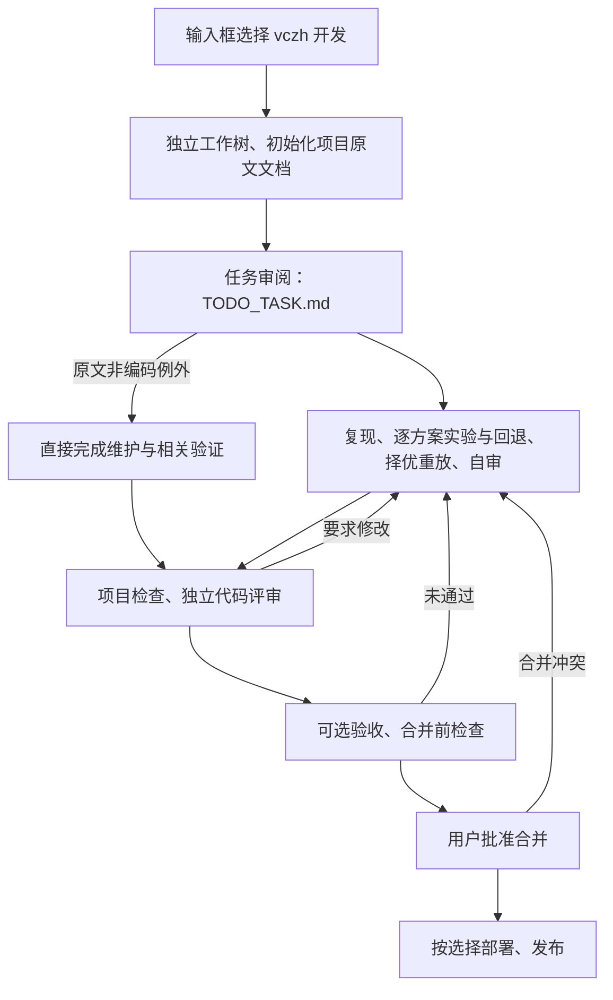

# vczh

在输入框选择“开发流程 → vczh 开发”，像简易开发一样使用：同一运行负责原文任务审阅、调查、检查、独立代码评审、可选验收、批准合并与按选择部署发布。工作流保留上游方法，移除原项目和固定工具链前提；内置规范只分发通用与 C++。

[来源与提取边界](SOURCES.md) · [review 记录](REVIEW.md)

## 输入框开发模式

安装插件后，`vczh-develop` 以 `kind=develop` 自动出现在输入框菜单。无需修改 composer 或 kickoff 卡片。需要官方 `review` 插件 2.17.0 或更新版本提供 `review-commit` 能力。



流程从所选分支的已提交内容建立独立调查工作树，保留原目录的未提交内容。原文实验与逐任务提交检查点保持不变；最终提交通过一条专属 PR 交付。这个 PR 不上报独立 PR 生命周期，其他 PR 的自动运行设置不受影响。

每个新提交重新检查与代码评审，验收也绑定到该提交；未完成的评审不能放行。未采纳意见与理由显示在批准卡。只有用户批准后才能合并到默认分支，部署与发布使用合并后的提交。默认 merge 保留调查提交历史，可在本插件设置修改。详细约定见 [开发模式](skills/vczh/references/develop.md)，或 `vczh protocol develop`。

规划、文档及构建/CI 维护保留原文直接执行的例外；纯问答和独立原文命令保留各自停止点。临时外部故障可在说明原因后重试原提交，不要求空提交。

项目的 `check`、`premerge`、`deploy`、`preview`、`release` 流程由项目声明；没声明的类别不会凭空执行。C++/CLI 的可选验收按 Project.md 准备可运行程序，不要求安装 Mac/iPhone 客户端。

## 独立原文命令

在项目对话中说「使用 vczh 工作流……」。Skill 读取当前项目约定，再按最新请求路由。`vczh protocol` 可阅读入口。

| 命令 | 行为 |
| --- | --- |
| `ask` | 研究分析，不改源码 |
| `investigate repro` | 归档旧调查、逐字保存需求、确认复现、逐个实验与回退、选择并重放最佳方案、复验与自审 |
| `investigate continue` | 追加 UPDATE；用户否定已确认方案时标记 DENIED BY USER；从 Step 5 继续 |
| `investigate report` | 追加 REPORT，比较已确认方案，停止后续执行 |
| `review` | 执行前审阅任务文件，保留用户原话，补 DETAILS / VERIFICATION / REVIEW COMMENTS |
| `refine` | 处理最早一组归档，提炼偏好、更新计数，删除已消费归档；一次一组 |
| `kb topic/ask/draft/improve/execute` | 分开研究、追问、起草、改稿、落入索引及正文 |
| `kb refine` | 对照学习与代码，更新本项目既有知识页 |

没有首词时，研究问题按 ask、编码按 investigate repro、其他非编码工作直接执行。规划、文档维护、构建/CI 脚本修正属于上游非编码例外。空 repro 读取 `TODO_TASK.md`，空 review 标记同一文件。

BPMN 负责路由、交接和恢复；调查内部按协议执行。原文的实验回退、提交推送、逐 Task 提交、rebase 后重测保留；执行时尊重用户指示、改动所有权与宿主权限。独立命令保持各自停止点，不自动开 PR；完整交付使用上面的输入框开发模式。

```sh
vczh init
vczh route --file /tmp/latest-request.txt --intent coding
vczh request start --file /tmp/latest-request.txt --intent coding
```

然后调用 `workflow_run`，workflow 为 `vczh`，inputs 为 `root` 与 `request`。固定任务文档串行使用，失败或中断恢复原运行，不重新清空调查。请求内的步骤以 Markdown 为准。

放弃无法继续的请求时，先确认原运行已结束，再执行 `vczh request abandon` 释放请求占用；任务、知识和学习文档保持原样。核验步骤见 [释放活动请求](skills/vczh/references/adapter.md#释放活动请求)。Coda 以持久化项目标识独占调度同项目的运行，恢复时也重新取得占用；状态快照本身不能阻止并发恢复。新请求必须等旧运行退出，已放弃请求再次绑定会失败。绑定路径单独保存，仓库改名不影响放弃时的核对。

## 先维度，再主题

| 内置维度 | 主题 |
| --- | --- |
| 通用 `general` | 正确性与错误处理、DRY 与抽象、依赖边界与上游修复、接口与所有权、值语义、并发与异步、跨平台设计、调试验证、MVVM |
| C++ `cpp` | 声明与头文件、格式与类型推导、实现隐藏、对象生命周期、RAII、C++20 与模板迭代、指针有效值、原子操作 |

通用默认启用；C++ 规范由用户按需启用。工作流只读取已启用规范，停用后不会按语言自动恢复。面板按「维度 → 主题 → 条目」浏览。条目保留英文原句、否定项、条件与例外，并附原提交行号；中文标题和适用说明由插件添加。混合条目仅删除库或工具专属片段，并标记删除位置，不将原库 API 改写为标准库 API。

```sh
vczh prompt list
vczh prompt show general
vczh prompt show cpp --topic raii
vczh prompt enable cpp
```

开发维护时先把全部 13 份 Guidelines 按通用、C++、vczh-libraries、toolchain 四个维度归类。后两类不进入插件；旧包、完整混合 Guidelines、构建运行脚本及共享上下文中的专属要求均已移除。四维审计和生成脚本只存在于仓库的 `docs/vczh-classification.md` 与 `scripts/vczh/`，不会随插件分发。当前项目的具体库与工具用法以项目自身约定为准。

`vczh source list` 仅列出分发的工作流协议；`vczh source <路径>` 不能读取已移除的 Guidelines。

## 自定义规范

`vczh prompt template <id>` 生成带主题目录的 schemaVersion 2 模板。按 scope、topics、sections 组织，正文包含做法、反面做法、原因和必要例外。不要为单向规则补造正反例。

`prompt put --file …`、`prompt enable/disable <id>` 管理项目版本。已有 schemaVersion 1，以及没有 topics 的 schemaVersion 2 仍可用。项目接口不能覆盖内置或已移除的内置 ID；内置仅由插件开发者维护。

旧版 workflow / vczh-project 的启用记录不再生效，init 或下次启停规范时清理这些配置；用户自己编写的规范文件与知识不会删除。面板保留的旧内置页面选择会返回项目总览。

## 知识与项目文件

```text
Project.md
.github/
  TaskLogs/
    Copilot_Investigate.md
    Copilot_KB.md
  KnowledgeBase/
    Index.md
    Index_<PROJECT>.md
    KB_<PROJECT>_<Category>.md
    KB_<PROJECT>_Design_<Topic>.md
    Learning.md
  Learning/
    Learning_Coding.md
    Learning_Testing.md
    YYYY-MM-DD-HH-mm-ss/Copilot_Investigate.md
  vczh/
    .gitignore
    project.json
    prompts/<id>.json
```

`init` 只补缺失的工作文档。根目录 Project.md 需要根据项目事实填写构建、测试、生成物和变更触发规则。`vczh remember` 保留调查全文到时间戳归档，再重置当前标记；`--earliest N` 列出最早归档。

请求、活动指针和锁放在 `git rev-parse --absolute-git-dir` 返回的工作树私有目录下的 `vczh/`。提交全部改动、检出旧提交或创建克隆不会传播运行占用。`init` 和 `request start` 会排除旧运行态并从 Git 索引移除已跟踪的副本，包括稀疏检出范围外的条目；保留现有工作区历史文件，遇到冲突的暂存版本会明确失败。升级前结束旧运行，再按 [运行态与升级](skills/vczh/references/adapter.md#运行态与升级) 继续工作。

面板直接读取 Markdown，展示知识、学习计数、归档、自定义规范和命令状态。只统计本后端登记的工作区；同一 Git 项目取最近登记且可读的一份，不累加分支副本。已保存的详情被删除或工作区失效、切换后，刷新会清除旧选择并返回总览；数据损坏等错误仍明确显示。第一版 .github/vczh 内的知识仍可在「旧版资料」阅读。

## 验证

```sh
node --test test/plugins/vczh.test.mjs test/plugins/vczh-rebuild.test.mjs
node bin/check.mjs plugins/vczh
node scripts/vczh/rebuild.mjs --source vczh/repos/Tools/Copilot --check
```

存在支持独占组及恢复后重新取组的本地 Coda 运行时时，可设置 `VCZH_CODA_RUNTIME` 并运行 `node --test test/plugins/vczh-bpmn.test.mjs`。宿主集成测试覆盖七个命令分支、取消恢复、取得终态证明后恢复原运行，以及失败步骤原地恢复时的独占组排队；测试代替 Agent 答复任务，不调用模型。没有本地运行时会跳过这两项，不能把跳过视为通过。

其他测试覆盖分发范围、正文指纹、来源与分类、主题导航、旧配置兼容、提交快照后的克隆和多工作树、旧运行态迁移、改名后放弃、失效详情恢复与归档浏览。生成校验额外对照固定版本原始文件，确保保留正文只有登记过的删节；重建会清理陈旧 upstream 文件及占据所需父目录的文件，`--check` 只报告这些残留。

重建在任何删除或写入前检查全部输出与退役路径的类型。输出路径是符号链接或目录时明确失败，保留原有输出树；`--check` 同样拒绝输出链接。正常文件写入同目录临时文件后再替换，避免改写链接指向的数据。替换是逐文件原子的，整棵输出树不作为一个事务提交。

这些检查验证协议内容与运行接线，不代表所有模型都能完全遵循自然语言指令。插件为 Apache-2.0，保留 [NOTICE](NOTICE)；不分发参考仓库产品源码与具体项目知识正文。
