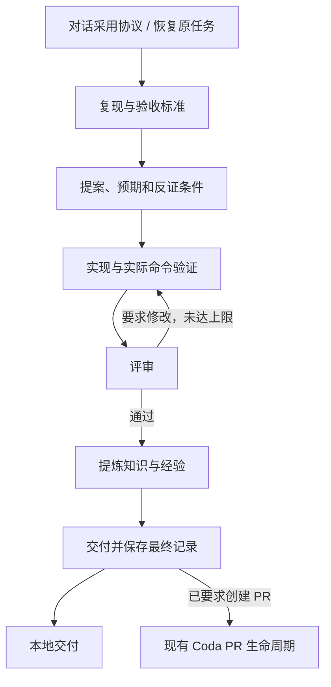

# vczh

把 vczh 的调查、证据交接和经验提炼方法用于普通项目的 Coda 插件。自带工作流、Skill、命令与知识/规范面板，不依赖第三方 npm 包。

## 使用

在 Coda「从仓库添加」中读取本仓库（HTTPS 仓库地址或本机仓库路径），选择 `plugins/vczh`。读取的是已提交版本。安装并在项目中启用后，新打开的项目会话能发现 `vczh` Skill 和会话指令。

在项目里说：

- 「使用 vczh 工作流，实现这个功能……」
- 「按 vczh 方法整理这个项目的知识库。」
- 「仿照 vczh 内置格式，写一份本项目的错误处理规范并启用。」
- 「这个 C++ 项目启用 vczh 的 C++ 规范。」

解释工作流、只读问答和审查材料不会自行启动修改任务。普通不涉及本协议的对话不强制载入整个规范库。

安装前可用 `node plugins/vczh/scripts/cli.mjs protocol` 阅读协议。安装后命令名为 `vczh`，`vczh help` 列出所有入口。

## 工作流



启动时先 `vczh init`，再 `vczh task start --title … --file …`，最后由会话调用 `workflow_run`，workflow 为 `vczh`，参数为 `root` 和 `task`。采用工作流不另外授权推送、合并、发布或联系他人。

工作流把每个阶段交给发起会话，自动步骤核对证据再推进。每个阶段的具体协议、JSON 格式由 `vczh protocol <阶段>` 提供。自审是默认路径，外部评审必须注明出处；需要独立评审时使用已有授权或 Coda PR 评审机制。

- **命令证据**：`vczh check <task-id> -- <命令> <参数>` 保存实际退出码、输出尾部和运行前后的文件指纹。引用检查 ID，不能只写“测试通过”。单次检查限 10 分钟、输出缓冲限 2 MiB。
- **代码变化**：指纹涵盖非忽略的跟踪/未跟踪文件、可执行位、链接目标、子模块内容和生效规范。TaskLogs 与知识正文不在代码指纹中，防止写证据使其自身失效。
- **顺序与恢复**：任务有阶段和递增版本；阶段推进可重试，另一条 run 不能接管原 task。`coda:key` 阻止同工作区/任务重复启动。失败或取消恢复原运行，根据落盘阶段继续。
- **修订**：在评审、沉淀或交付阶段发现代码变化，用 `task revise` 退回实现。评审修改上限默认 3，项目可在 project.json 调整。
- **最终保存**：delivery 后再交给会话保存最终状态。PR 模式要求 `.github/vczh` 没有未提交改动；会话负责确认已经推送。Vczh 完成表示交付已接续，不表示 PR 已合并或发布。

自动脚本只核对证据、推进状态，不修改产品源码、不强制提交，也不执行来自知识文件的命令。所有源码修改和验证在发起会话的原工作区发生。该实现使用同机工作区路径，暂不支持阶段迁移到另一台机器。

## 项目数据与总览

```text
.github/vczh/
  project.json           项目标识、启用规范、评审上限
  Project.md             项目构建入口、模块边界、生成物规则
  KnowledgeBase/
    Index.md             生成的按需阅读索引
    <id>.md              知识正文、来源指纹、状态和任务引用
  Learning/
    Index.md
    <id>.md              带适用边界的经验，按独立任务累计来源
  prompts/<id>.json      项目自定义规范
  TaskLogs/<task-id>/    原始需求、状态、检查结果、各阶段证据
```

所有知识正文均为 Markdown，头部 HTML 注释含机器元数据。用 `kb put` 写入、更新索引和校验来源。知识不是插件全局数据库：Git 中的项目文件是权威来源。旧项目的 `.github/KnowledgeBase` 不会被覆盖或自动迁移。

面板显示已登记项目数、知识/经验/规范数、任务状态、来源已变化的条目，能分页浏览全文和两套内置规范。项目使用 `init` 或项目命令后登记。只读扫描本后端登记过的工作区，不私自遍历磁盘或 Coda 数据库。

同一项目的多个 Git 工作树共享 projectId；总览选最近登记且仍可读的一份，不把多个分支副本累加。界面标出实际路径。工作树已回收时会尝试该项目其他已登记副本；全部失效则显示无法读取，不能当作零知识。此版本不是跨机器、跨分支合并的统计系统。

条目状态：

| 状态 | 含义 |
| --- | --- |
| current | 标为 confirmed，且来源文件内容仍与核对时一致 |
| stale | 来源文件变更、删除或无法读取，需要复核 |
| hypothesis | 尚未证实的假说，不作为强制规范 |
| deprecated | 已废弃，保留来源及替代说明 |

current 不是自动真理验证。来源指纹只能发现文本变化，不能证明推理正确或运行环境没有变化。知识更新要核对实际来源，不能机械刷新指纹。

## 规范与维护权

通用包 `general` 初始启用；C++ 包 `cpp` 内置但需按项目启用。两套规则均包含：适用范围、应该做、不要做、配对示例、例外、检查问题和固定提交来源。它们是改写与抽象，不是原文的逐字复制，原文与适配边界见 [SOURCES.md](SOURCES.md)。

`vczh prompt template <新id>` 输出同样格式，`prompt put --file …` 保存项目版本，`prompt enable/disable <id>` 管理启用状态。项目 API 拒绝覆盖 general、cpp；如需局部替代，建新 ID，写明覆盖范围，再决定是否停用旧包。

内置维护在此插件的 `prompts/*.json`，由插件开发者修改并随版本发布。项目的学习不会自动进入全局默认。提炼新规则时须检查：是否独立于原项目、正反例是否切中同一边界、例外是否充分、来源是否可追溯。

## 验证

```sh
node --test test/plugins/vczh.test.mjs
node --test --test-name-pattern='skills are|plugins/vczh' test/check.test.mjs test/plugins/plugins.test.mjs
node bin/check.mjs plugins/vczh
```

还应使用 Coda `workflow_check` 检查 `.coda/workflows/vczh.bpmn`。根检查器补充了原生 `contributes.skills` 的目录、同名和越界检查；没有改动 ACP 协议版本。

这些检查覆盖数据持久化、幂等推进、证据过期、评审退回、重试上限、知识去重、路径边界、原生面板格式与分页、CLI 和工作流脚本。它们不冒充真实 Agent 的行为评估或 GitHub 端到端合并验收。

本次还以运行中的 Coda 所用 `bpmn-engine`、FEEL 表达式求值器和 moddle 定义执行了实际 BPMN，调用真实阶段脚本，在临时 Git 工作区跑通复现、提案、一次评审退回、重新实现、通过、沉淀、交付和最终归档。人工任务由测试驱动答复，不调用真实 Agent 或远端服务。

## 优缺点与后续方向

| 设计 | 收益 | 代价或边界 |
| --- | --- | --- |
| 阶段证据与文件交接 | 可恢复、可审计，减少聊天记忆丢失 | 小改动也有流程开销；模板不能判断证据是否充分 |
| 知识与代码同仓 | 可评审、可回滚，项目所有权清晰 | 多分支编辑可能冲突，工作区回收前要保存 |
| 正反配对的偏好 | 明确判断边界，比口号可执行 | 例外不足会把个人偏好变成错误禁令 |
| 内置与项目规范分开 | 开发者控制公共默认，项目可独立演进 | 版本升级后的冲突仍需人工判断 |
| 按来源指纹提示过期 | 不会无条件长期信任旧结论 | 文件级检测较粗，语义变化和环境漂移识别不足 |
| 复用 PR 生命周期 | 保留现有评审、检查、批准和发布政策 | Vczh 阶段完成与 PR 最终完成是两个状态 |

优先完善方向：

1. 用小型真实任务集评估协议：缺陷、纯文档、生成物、跨仓依赖各一类，统计时间、返工和知识复用，形成轻量/完整两种节奏。
2. 加入可选的独立审查、需求到测试的关联与可信 CI 结果；现有 JSON 证据是协作记录，不是防篡改安全边界。
3. 将来源细化为符号、代码范围及构建环境；增加“复核/替代”流程，分开记录观察次数、适用范围和可信度。
4. 接入 Coda 正式项目资源接口，按默认分支快照统计；提供多机汇总、失效登记清理与分支差异查看。
5. 给规范增加逐条 ID、版本与升级差异预览；将项目经验提升为内置规范时由开发者评审，禁止自动污染公共默认。
6. 增加查询、历史版本比较和冲突提示；用真实复用频率决定是否需要全文索引或检索系统，不先引入复杂服务。

插件许可证为 Apache-2.0，归因见 [NOTICE](NOTICE)；三个参考仓库本身不随插件分发。
